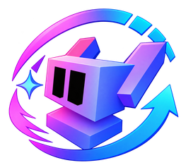

# Optimize Your Project for Blender 4.2+



**Current Blender version: 0.8.9**

The sidebar is intentionally minimal. Select a mesh in **Object Mode**, press **N** in the 3D Viewport, and open the **FISHHWB** tab.

## Install / Download Optimize Your Project

Supported Blender 4.2+ builds can install this ZIP as an extension.

1. Open the latest successful **Check release packages** build on GitHub:
   https://github.com/dedzedofficial/Optimize-Your-Project/actions/workflows/release-checks.yml
2. Download artifact **optimize-your-project-blender-0.8.9** and extract the artifact container ZIP if GitHub wraps it.
3. Install **optimize-your-project-blender-extension-0.8.9.zip** using **Edit > Preferences > Get Extensions > Install from Disk**. Do not unzip the extension ZIP itself.
4. Disable/remove any previously installed 0.8.5/0.8.8 duplicate extension, restart Blender, and enable the 0.8.9 extension.

## Sidebar layout

```text
OPTIMIZE YOUR PROJECT

Language: [ Auto / English / ... ]

CURRENT SELECTION
ObjectName
Triangles: ...
Vertices: ...
Faces: ...

[ SMART REMESH ]
Triangle Limit: ...

[ CREATE LODS ]

[ MERGE MATERIALS ]
```

### Smart Remesh

**Runs even when the mesh has fewer triangles than the target and on earlier generated Remesh objects.** The triangle setting is a best-effort **budget**, not a guarantee that a quad topology has precisely that many triangles.

- Creates a private output copy without modifying the selected mesh or previously generated results.
- For static meshes, evaluates existing modifiers on the private copy before reconstruction. For rigged meshes, preserves supported armature modifiers instead of baking the pose.
- Repairs near-duplicate vertices, degenerate/loose geometry and small boundary loops, and attempts to join nearby surface gaps with controlled voxel reconstruction. It does not indiscriminately connect legitimate separate mesh islands or seal every intentional opening.
- Runs voxel reconstruction and attempts QuadriFlow quad retopology. If QuadriFlow fails but the voxel output is valid, it reports **voxel quad topology**, not QuadriFlow success.
- Attempts triangle reduction or adds topology where useful, staying within safety and detail limits; subdivision does not invent new sculpted detail.
- Reprojects supported UVs, material slots and face material IDs.
- For compatible relative shape keys, vertex groups and armature modifiers, reprojects blendshape deltas and weights onto the new vertices, and restores the original relative shape-key configuration and supported animation bindings. **Review the result**: nearest-surface interpolation can distort weights, facial expression shapes, texture seams and details.

Unsupported custom mesh attributes, absolute shape keys, shape-key NLA tracks and non-armature modifier stacks on rigged sources are **not silently destroyed**. The operator refuses those cases with a reason and preserves the source. Models with highly intricate geometry may require manual retopology and corrections.

Very high target limits (above 500,000) are rejected for memory/performance safety.

### Create LODs

Creates LOD0, LOD1 and LOD2 using existing safe triangle budgets. Source mesh is preserved; LODs are static-mesh only. Previous advanced preferences continue to exist but are deliberately not displayed in the main sidebar.

### Merge Materials

The button uses the existing **Merge Textures** atlas workflow to reduce compatible materials to one packed material with rebuilt AtlasUV. This operation is not a plain same-material-slot deduplicator: it may bake textures, and it rejects unsupported complex shaders instead of corrupting them. Original materials remain unchanged on the source.

## When the target cannot be safely met

The resulting operator message explains whether it used QuadriFlow, kept voxel quads, or rejected an unsupported source. Inspect the output's wireframe, UVs, shape keys, bones/weights and shading before exporting it to Unity or VRChat.

## Other retained tools

Legacy Clean Mesh, Lightmap UV, identical mesh linking, collider stripping and the more configurable Remesh workflow remain registered and available through Blender operator search (F3); they are hidden from the compact sidebar rather than deleted.

## Previous version history

See [CHANGELOG.md](../CHANGELOG.md) and the [main README](../README.md).
